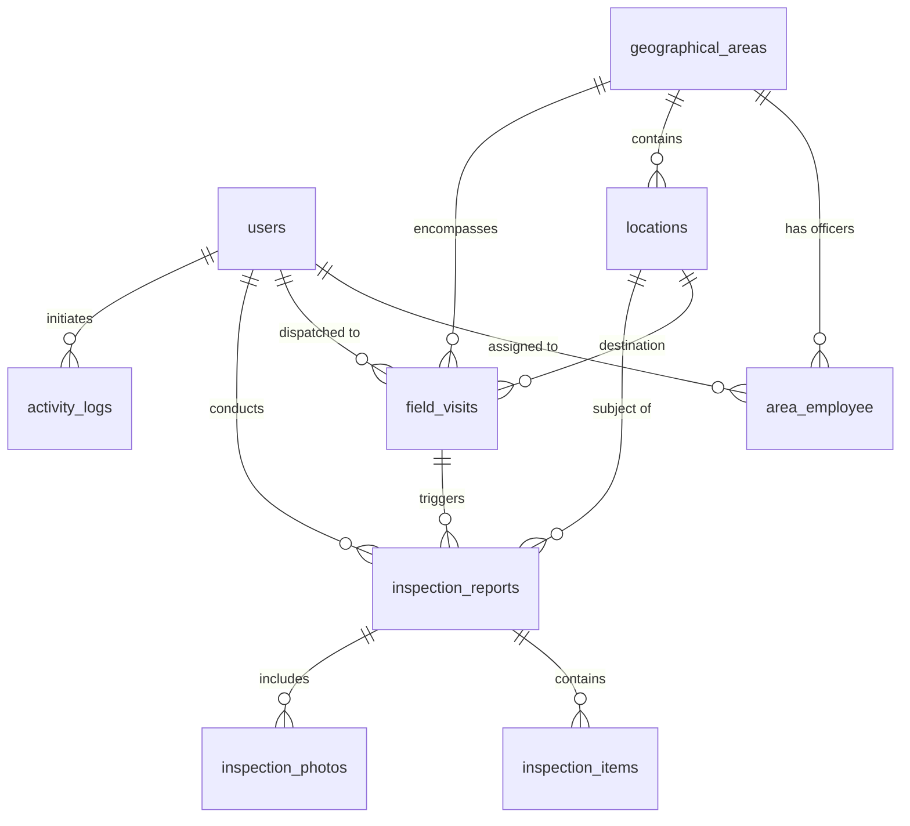

# FieldTrack — Employee Field Monitoring Information System


**FieldTrack** is an enterprise-grade web application built to monitor, coordinate, evaluate, and audit field employees and operations across geographical territories in real time.

---

## 🌟 Core System Modules

### 1. 🗺️ Geographical Areas & Territory Assignments (`/areas`)
* **Geographical Territories:** Define designated operational areas (zones) with center latitude/longitude, city/province, custom color code, and radius coverage in meters.
* **Employee Assignment:** Assign one or more field officers to a territory with specialized roles:
  * **Lead Inspector** — Primary accountable inspector for all sites within the zone.
  * **Field Safety Officer** — Focuses on safety, health, and emergency egress audits.
  * **Logistics Quality Auditor** — Focuses on distribution centers, freight, and cargo points.
  * **Specialist Technician** — Manages critical data centers, HVAC, and industrial machinery.
  * **Backup Auditor** — On-call secondary support during peak schedules.
* Configure assignment start dates, expiry dates, primary officer flags, and dispatch notes.

### 2. 📍 Field Visits & GPS Geofencing (`/visits`)
* **Visit Dispatch:** Dispatch scheduled or routine field visits to employees with date/time, destination site, and purpose (*Routine Inspection*, *Compliance Audit*, *Preventive Maintenance*, *Emergency*, *Client Meeting*).
* **GPS Check-In:**
  * Uses the browser's `navigator.geolocation` API to capture the field officer's exact device coordinates.
  * Calculates distance to the site in meters using the **Haversine formula**.
  * Verifies whether check-in occurred within the allowed **geofence radius** (e.g. 100m–150m) or flags an out-of-bounds warning.
* **GPS Check-Out:** Records departure coordinates, calculates on-site duration in minutes, captures visit completion summaries, and client sign-off names.

### 3. 📌 Display Assigned Locations (`/locations`)
* **Interactive Map & Directory:** View all assigned client premises, stores, towers, offices, and warehouses.
* **Geofence Overlays:** Visualizes radial geofence boundaries around each client site.
* **Dual View:** Switch seamlessly between **Card/Table Directory** and **Full Map Mode**.
* **GPS Coordinate Picker:** Click "Use My Current GPS Position" to auto-fill latitude and longitude when registering new sites.

### 4. 📋 Track Inspection Reports (`/inspections`)
* **Inspection Dossier:** Track audits with overall compliance scores (0–100%), result grades (*Passed*, *Warning / Needs Improvement*, *Failed*), and approval statuses (*Submitted*, *Under Review*, *Approved*, *Rejected*).
* **Dynamic Checklist Builder:** Add dynamic checklist items with pass/fail/na statuses, severity flags (*Low*, *Medium*, *High*, *Critical*), and notes.
* **Supervisor Review & Approval:** Supervisors review findings, assign decision statuses (*Approved*, *Rejected*, *Under Review*), and record quality remarks.

### 5. ⏱️ Activity History & Audit Trail (`/activities`)
* **Comprehensive Chronological Stream:** Records every operational event:
  * Territory assignments & removals
  * Field visit dispatches, check-ins, and check-outs
  * Inspection report submissions and approval decisions
  * User logins and demo role switches
* **Geospatial Grounding:** Displays recorded GPS coordinates with one-click links to Google Maps alongside IP addresses.

### 6. 👥 Staff & Role Management (`/users`)
* Full administrative directory of all staff accounts.
* Filter and search employees by system role, operational status (*Active*, *Inactive*, *On Leave*), and assigned territories.
* Create, edit, and update staff credentials, phone numbers, and permission roles.

### 7. 🌍 Multi-Provider Interactive Maps & Google Maps Integration
* **Map Layer Switcher** available on every map and in the top navigation bar:
  * **Street Map:** OpenStreetMap Standard
  * **Google Satellite / Hybrid:** High-resolution satellite imagery (Esri World Imagery)
  * **Light Minimalist:** Carto Positron
  * **Dark Mode:** Carto Dark Matter (for night monitoring operations)
  * **Topographic:** OpenTopoMap
* **Google Maps API Integration:** Built-in modal supporting custom Google Maps JavaScript API keys.
* **Real-time "Locate My Device" GPS button:** Immediately pulses and centers the map on your physical device location.

---

## 👥 System Roles & Permissions (RBAC)

| Role | System Key | Dashboard Access | Geographical Areas | Locations | Field Visits | Inspection Reports | Staff Management |
| :--- | :--- | :---: | :---: | :---: | :---: | :---: | :---: |
| **Administrator** | `admin` | Full | Create / Edit / Assign | Create / Edit / Delete | Full Control | Full Control | Full Control |
| **Supervisor** | `supervisor` | Full | View & Assign | View & Edit | Schedule & Monitor | Review & Approve | View Staff |
| **Field Officer** | `field_officer` | Full | View Assigned | View Assigned | Check-In / Check-Out | Submit Reports | View Profile |

---

## 🔑 Pre-Configured Demo Accounts

For testing, you can either sign in with these credentials or use the **1-Click Quick Demo Login Switcher** on the login page:

| Role | Name | Email | Password |
| :--- | :--- | :--- | :--- |
| **Administrator** | Alexander Vance | `admin@fieldmonitor.com` | `password` |
| **Supervisor** | Sarah Jenkins | `supervisor@fieldmonitor.com` | `password` |
| **Field Officer** | Ahmad Rifai | `ahmad.rifai@fieldmonitor.com` | `password` |
| **Field Officer** | Dewi Lestari | `dewi.lestari@fieldmonitor.com` | `password` |
| **Field Officer** | Rian Pratama | `rian.pratama@fieldmonitor.com` | `password` |
| **Field Officer** | Maya Indah | `maya.indah@fieldmonitor.com` | `password` |

---

## 🗄️ Database Architecture (PostgreSQL 18)



### Table Overview:
1. `users` — Staff credentials, employee ID, role (`admin`, `supervisor`, `field_officer`), status, live GPS coordinates, and last active timestamp.
2. `geographical_areas` — Operational territories with center lat/lng, radius (meters), color code, city, and GeoJSON.
3. `area_employee` — Pivot table linking officers to zones with `role_in_area`, `assigned_date`, `expiry_date`, and `is_primary` flag.
4. `locations` — Client sites with GPS coordinates, address, contact person, priority, and `geofence_radius_meters`.
5. `field_visits` — Visit logs with scheduled time, check-in GPS, check-in distance, `is_within_geofence`, check-out GPS, duration, and summary.
6. `inspection_reports` — Site audit dossiers with compliance score (%), result grade (*Passed*, *Warning*, *Failed*), and review remarks.
7. `inspection_items` — Dynamic checklist questions with pass/fail/na and severity rating.
8. `activity_logs` — Immutable audit trail with event title, details, user, IP, and GPS coordinates.

---

## 🚀 Installation & Local Setup

### Prerequisites
* **PHP 8.3 or higher** with `pdo_pgsql`, `pgsql`, `mbstring`, `openssl`, `curl`, `fileinfo` extensions enabled.
* **PostgreSQL 18** running on port `5433` (or default `5432`).
* **Composer 2.8+**

### 1. Environment Configuration (`.env`)
Ensure your `.env` contains the PostgreSQL 18 connection settings:

```dotenv
APP_NAME="FieldTrack Monitoring"
APP_ENV=local
APP_KEY=base64:XG8d2L5BqBwD0zN5xM6K+e4Y7ZpW1vQ8sR3tU9vX0yA=
APP_DEBUG=true
APP_URL=http://127.0.0.1:8000

DB_CONNECTION=pgsql
DB_HOST=127.0.0.1
DB_PORT=5433
DB_DATABASE=employee_field_monitoring
DB_USERNAME=postgres
DB_PASSWORD=rahasia
```

### 2. Run Database Migrations & Seeders
Create all database tables and load realistic sample data (zones, locations, visits, reports, audit logs):

```bash
php artisan migrate --seed
```

### 3. Run Automated Tests
Execute the comprehensive test suite covering all core requirements:

```bash
php artisan test tests/Feature/FieldMonitoringTest.php
```

### 4. Start the Application Server
Start the local development server:

```bash
php artisan serve --port=8000
```

Open your browser at: **[http://127.0.0.1:8000](http://127.0.0.1:8000)**

---

## 📡 Geospatial REST API

### `GET /api/map-data`
Returns live JSON data for interactive mapping overlays:
* **Query Parameters:**
  * `area_id` *(optional)* — Filter by specific geographical territory.
  * `user_id` *(optional)* — Filter by specific field officer.
* **Response Payload:**
  * `areas`: Array of territories with center coordinates, radius, color, and assigned officers.
  * `locations`: Array of client sites with lat/lng, geofence radius, and contact info.
  * `employees`: Active field staff with live GPS coordinates, status, and last seen timestamps.
  * `today_visits`: Today's scheduled and active field visits.

---

## 📜 License
Open-source software licensed under the [MIT license](LICENSE).
